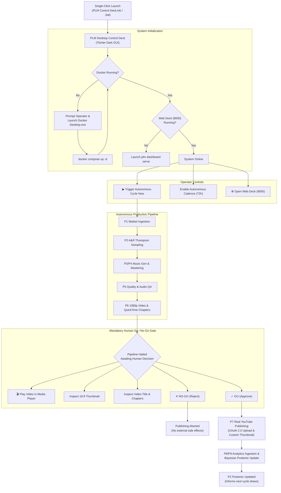

# PLM Session Handoff — 2026-10-21

**Session Goal:** Implement an autonomous continuous execution loop with operator-controlled publishing cadence (2~3 releases per week), mandatory Human Go/No-Go review gate (video title, thumbnail, and audio/music inspection), and a standalone single-click desktop control deck with Docker health auto-detection and web dashboard integration.

---

## 1. Executive Summary & Capabilities Delivered

In this session, the PLM system advanced from a manual-step architecture to a **fully integrated, closed-loop autonomous engine** with an operator-friendly desktop control deck:

1. **Closed-Loop Bayesian Cycle (P9 → P2)**:
   - Ingests real performance metrics via YouTube Analytics API v2 (`reports.query`) for published media on channel *Rhodes & Rain Records* (`UC3Ps0F0z8Mw9ftakIcZ1cWA`).
   - Normalizes rewards under `engagement-contribution-proxy-v1`.
   - Delivers rewards via Seam C7 leg-2 (`POST /ar/results`).
   - Applies Bayesian updates via `POST /ar/update`, dynamically shifting posterior distributions (`lofi_study_focus` posterior mean: $0.40825 \to 0.45798$, variance: $0.10649 \to 0.04878$) to inform subsequent Thompson Sampling arm allocations.

2. **Autonomous Loop Worker (`scripts/autonomous_loop_worker.py`)**:
   - Implements automated multi-stage orchestration across P1 (Market) → P2 (A&R) → P3 (Genome) → P4 (Music Gen) → P5 (QA) → P6 (1080p Video Assembly).
   - Configurable publishing cadence: default 72 hours (~2.3 releases per week) to prevent YouTube channel spamming while building algorithm momentum.
   - Fault-tolerant HTTP handling with automatic fallback to active default opportunities if Market API is temporarily unreachable.

3. **Mandatory Human Go / No-Go Gate**:
   - Completely halts execution prior to external YouTube upload.
   - Enforces operator review across:
     - **Music / Audio Master Quality**: Direct media player launcher.
     - **Video Title**: Exact metadata review.
     - **Thumbnail Image**: High-resolution 16:9 visual preview.
     - **Tracklist & Chapters**: Timestamp inspection.
   - Only an explicit `[✓ GO]` operator decision permits external write authorization; a `[✕ NO-GO]` decision aborts publication without side effects.

4. **Standalone Desktop Control Deck (`scripts/plm_desktop_control.py`)**:
   - High-performance, dark-themed Tkinter + Pillow desktop application.
   - **Docker Desktop Auto-Detection & Boot**: Checks `docker ps` on launch. If Docker Desktop is stopped, prompts the operator and launches `C:\Program Files\Docker\Docker\Docker Desktop.exe`, polling until the daemon is responsive, then runs `docker compose up -d`.
   - **Service Health Dashboard**: Real-time status indicators for Docker, Microservices (P1–P9), Postgres (5432), and Web Deck (8000).
   - **One-Click Manual Trigger**: Prominent button to trigger a production cycle on demand.
   - **Live Progress & Audit Terminal**: Live progress bar (0–100%) and embedded colorized audit console logging every API call and decision.
   - **Embedded Human Gate Card**: Displays title, thumbnail preview, "Play Video in Media Player" button (`os.startfile`), and Go/No-Go action buttons.
   - **Web Deck Launcher**: Top-bar button to instantly launch `http://127.0.0.1:8000` in the default browser.

5. **Single-Click Desktop & Repository Launchers**:
   - `C:\Users\riper\Desktop\PLM Control Deck.lnk` (Windows Desktop Shortcut)
   - `C:\Users\riper\Desktop\PLM Control Deck.bat` (Desktop Batch Launcher)
   - `C:\Users\riper\Downloads\PLM\PLM_Control_Deck.bat` (Repository Root Launcher)

---

## 2. Key Files & Artifacts Created / Modified

| Path | Purpose |
|---|---|
| `scripts/plm_desktop_control.py` | Complete desktop GUI application (Docker booter, loop controls, progress bar, gate card, console). |
| `scripts/autonomous_loop_worker.py` | Autonomous worker script with 72h cadence scheduling and terminal Go/No-Go gate. |
| `PLM_Control_Deck.bat` | Repo root batch launcher setting environment tokens and activating `.venv`. |
| `C:\Users\riper\Desktop\PLM Control Deck.lnk` | Windows Desktop shortcut for single-click execution. |
| `config/dev/reviewers.json` | Reviewer authorization directory for Web Control Deck exception overrides. |
| `docs/STATUS.md` | Source-of-truth status document updated with Desktop Control Deck & Worker capabilities. |
| `output_media/full_album/midnight_rain_and_rhodes_album_1080p.mp4` | 50m 48s 1080p master album video (16 tracks) verified and linked in gate. |
| `output_media/thumbnails/midnight_rain_cover.png` | 16:9 album cover thumbnail rendered in gate UI preview. |

---

## 3. Architecture & Execution Flow



---

## 4. Verification & Testing Evidence

All quality gates and behavioural invariants were verified in this session:

- **Unit & Contract Tests**:
  ```bash
  .venv\Scripts\pytest.exe -m "not integration" -q --tb=line
  # Result: 2005 passed, 1 skipped, 68 deselected, 14 warnings in 235.28s (0:03:55)
  ```
- **Static Code Linting**:
  ```bash
  .venv\Scripts\ruff.exe check .
  # Result: All checks passed!
  ```
- **Static Type Checking**:
  ```bash
  .venv\Scripts\mypy.exe packages services
  # Result: Success: no issues found in 442 source files
  ```
- **Runtime Import Isolation**:
  ```bash
  .venv\Scripts\pytest.exe tests/unit/test_runtime_imports.py
  # Result: 1 passed (no runtime code imports from tests/)
  ```
- **Active Backend Containers (`docker compose ps`)**:
  - All 15 containers operational: `api-analytics`, `api-ar`, `api-distribution`, `api-experiments`, `api-market`, `api-media`, `api-music`, `api-qa`, `api-youtube`, `postgres`, `minio`, `temporal`, `p1-worker`, `pipeline-worker`.

---

## 5. Instructions for Next Session / Operator

1. **Starting the System**:
   - Double-click the **`PLM Control Deck`** icon on your Desktop.
   - If Docker is not open, click **Yes** when prompted; the application will handle booting Docker Desktop and the container stack.
2. **Reviewing Web Views**:
   - Click **`🌐 Open Web Deck (8000)`** to view the Command Center, Market Map, Production Queue, Experiment Board, Unit Economics, and Exception Queue.
3. **Triggering Cycles**:
   - Click **`▶ Trigger Autonomous Cycle Now`** for an on-demand cycle, or check **`Enable Autonomous Cadence`** to leave the engine running on its 72-hour publishing schedule.
4. **Conducting Gate Reviews**:
   - When the pipeline reaches Step 6/8, review the thumbnail and title in the gate card.
   - Click **`🎬 Play Video / Music in Player`** to listen to the album master.
   - Click **`✓ GO (Approve & Publish)`** to send to YouTube, or **`✕ NO-GO`** to discard.

---

## 6. Open Items & Future Roadmap

- **R6 Live DSP Distribution**: Connect real DistroKid/TuneCore/Fuga distribution adapters in P8 (currently mock).
- **Unit Economics Realization**: Move from bounded proxy rewards (`engagement-contribution-proxy-v1`) to actual currency statements as DSP streaming revenue statements become available.

